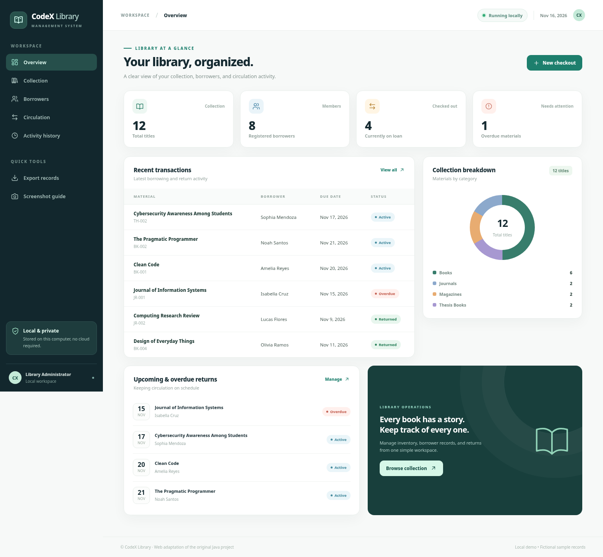
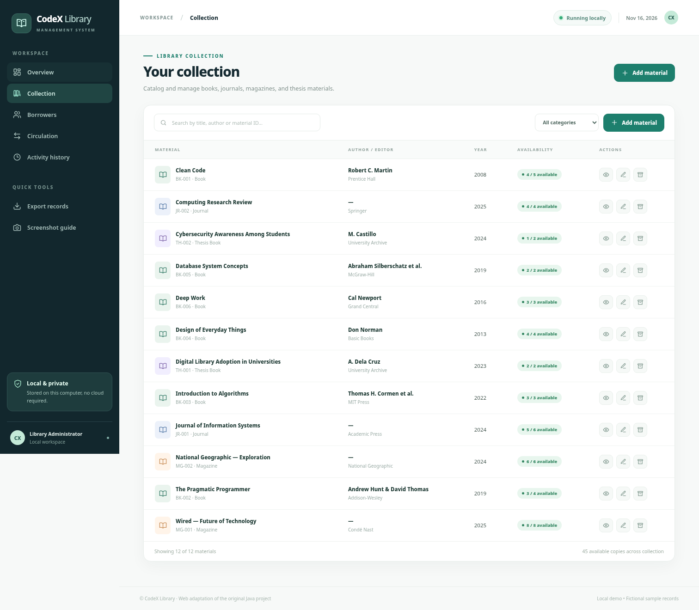
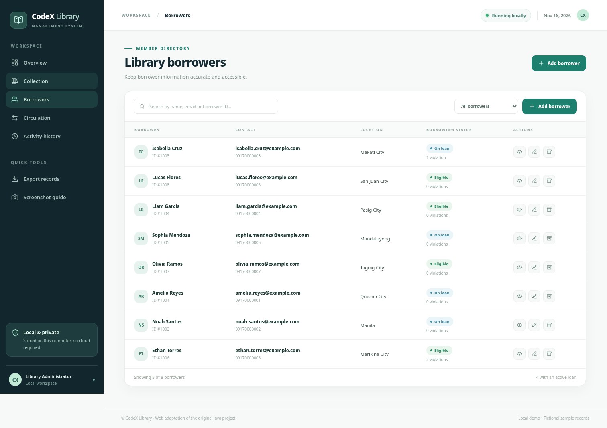
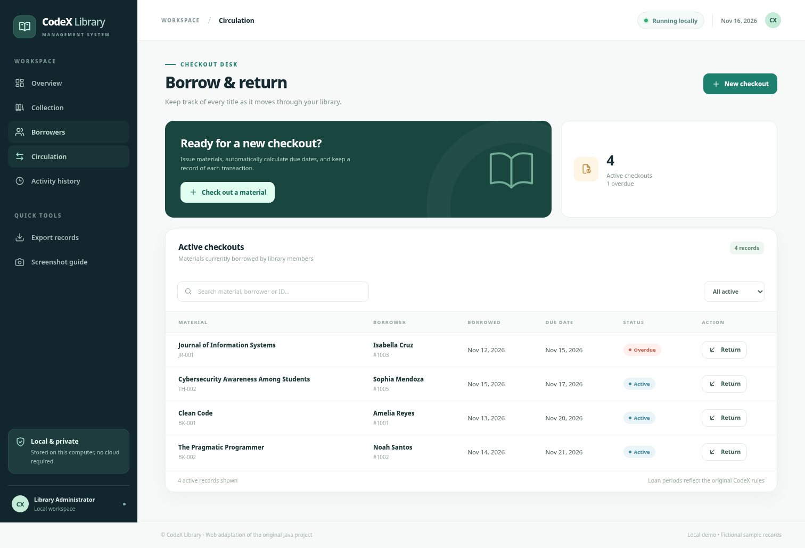

# CodeX Library Management System — Web Application

A responsive, functional **library-management web application**, adapted from the original [CodeX Library Management System](https://github.com/kichiya999x/codex_library_system), a Java console project.

This separate repository contains a **new web adaptation**, not the original Java application's UI. It uses **Python, SQLite, HTML, CSS, and vanilla JavaScript**. It runs entirely on your computer with no third-party Python packages or separate database server.



## Key features

- **Overview:** library statistics, material categories, recent circulation, upcoming returns, and overdue loans
- **Collection:** add, edit, archive, search, and filter books, journals, magazines, and thesis books
- **Borrowers:** register and manage borrowers, track violations, and review borrower history
- **Circulation:** check out and return materials, calculate due dates, and automatically update availability
- **Activity history:** permanent loan and return records, including overdue and late returns
- **Data export:** export library records as JSON
- **Local persistence:** SQLite database created automatically at first launch

## Screenshots

| Overview | Collection |
| --- | --- |
|  |  |

| Borrowers | Circulation |
| --- | --- |
|  |  |

More screenshots are available in [`screenshots/`](screenshots/).

## Getting started

**Requirements:** Python 3.9+; no `pip install` needed.

### Windows

1. Download or clone this repository.
2. Double-click **`START_CODEX_WINDOWS.bat`**.
3. Open **http://127.0.0.1:8766** if the browser does not open automatically.
4. Keep the terminal window open while using CodeX.

### macOS / Linux

```bash
python3 server.py
```

You may also run `./START_CODEX_MAC_LINUX.sh` after granting execute permissions.

The preferred port is **8766** to avoid conflict with a portfolio website on port 8765. If port 8766 is busy, CodeX tries higher ports automatically. Check the terminal for the final address. You can choose a port explicitly with `python server.py --port 9000`.

## Using the demo

The application seeds **fictional example records** when the local database is first created. Changes are saved to `codex_library.sqlite3` in the project folder; this database is excluded from Git by `.gitignore`.

To reset the sample database: stop the application, back up/export any data you need, delete `codex_library.sqlite3`, and restart. You can also use the application’s demo reset action.

> **Privacy:** Do not commit your local SQLite database, borrower details, or exported user records. The included screenshots use fictional sample data.

## Tech stack

| Layer | Technology |
| --- | --- |
| Frontend | HTML5, CSS3, vanilla JavaScript |
| Backend | Python 3 standard-library HTTP server |
| Database | SQLite 3 |
| Testing | Python `unittest` |

## Tests

```bash
python -m unittest discover -s tests -v
```

The regression tests cover data seeding, borrowers, materials, circulation, overdue handling, archiving, reset, and exports.

## Repository structure

```text
.
├── server.py                     # Local API, SQLite schema, business logic
├── static/                       # Frontend HTML, CSS, JavaScript and icon
├── screenshots/                  # Actual screenshots of the running web app
├── tests/test_api.py             # Automated regression tests
├── START_CODEX_WINDOWS.bat       # Windows launch shortcut
├── START_CODEX_MAC_LINUX.sh      # macOS/Linux launch shortcut
└── README.md
```

## Design and implementation notes

The original Java application supported borrower and asset management, borrow/return operations, and histories through a terminal menu. This adaptation implements those workflows in a web UI with SQLite-backed persistence and additional filtering, dashboard, and export capabilities. Loan durations follow the material-specific limits used by the original Java return logic: 7 days (books), 3 (journals), 1 (magazines), and 2 (thesis books).

**Local demo only:** the HTTP server binds to `127.0.0.1`. This project does not include authentication or production hosting configuration. Do not expose it directly to the public internet without additional security and deployment work.

## Project lineage

- **Original Java console version:** https://github.com/kichiya999x/codex_library_system
- **Web adaptation:** this repository